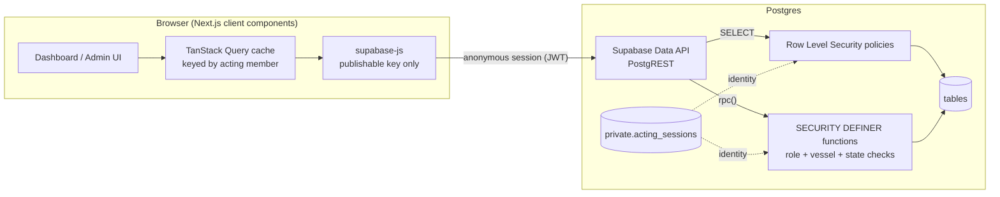
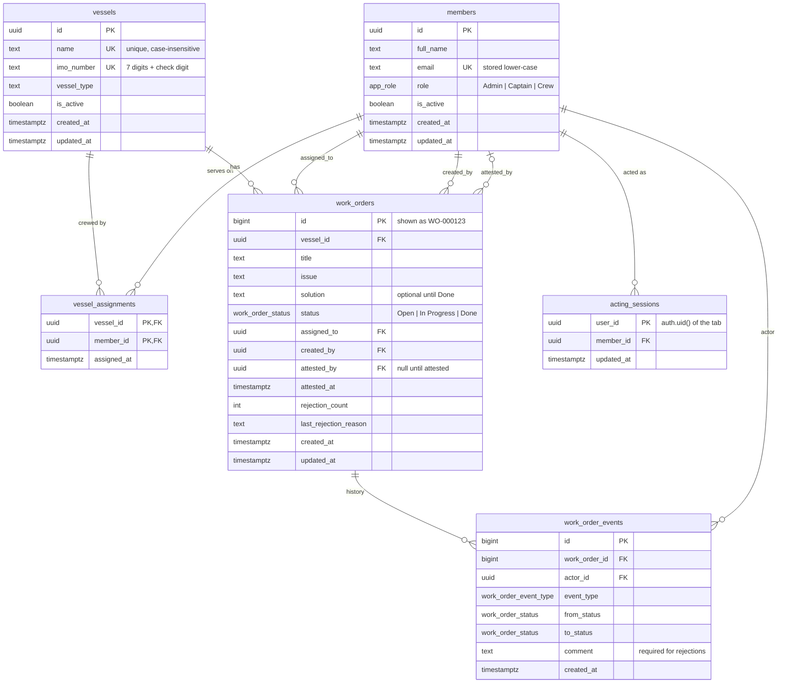
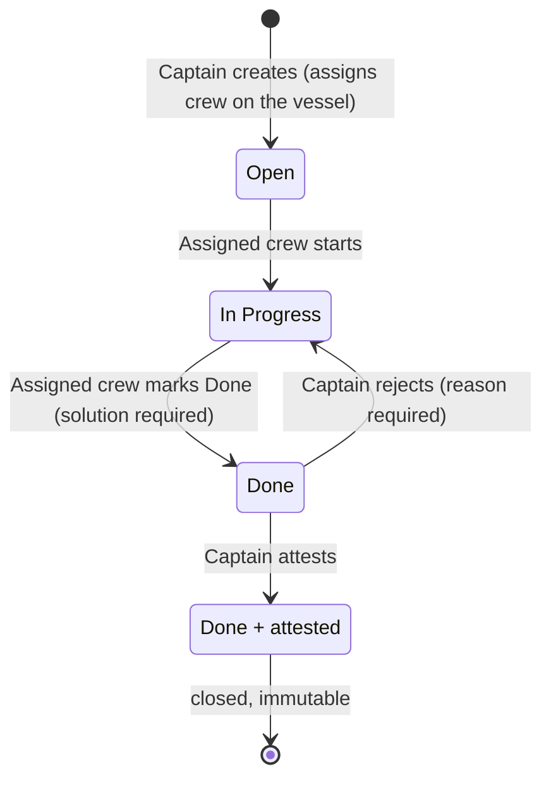

# FleetOps · Marine Work Order Management

A vessel-scoped work order dashboard for a cruise fleet: Admins manage users, roles, vessels and assignments; Captains create and review work orders; Crew carry them out. Every permission is enforced **inside Postgres**, not only in the UI.

- **Live demo:** https://marine-work-orders.vercel.app (no login needed)
- **Stack:** Next.js 16 (App Router) · TypeScript · Supabase (Postgres, RLS, RPC) · TanStack Query · Tailwind CSS 4 · Vercel

---

## Reviewer quick tour (5 minutes)

The sticky bar at the top is the mock login: **1 · Vessel → 2 · Role → 3 · Member**. Picking a member switches the database session to that person instantly.

> **Tip:** each browser tab is its own session. Open two tabs to watch a Captain and a Crew member side by side.

1. **Captain:** Vessel *MV Coral Meridian* → Role *Captain* → *Elena Vasquez*. Click **New work order** and assign it to *Noah Williams*. It starts as **Open**.
2. **Crew:** Role *Crew* → *Noah Williams*. Open the work order → **Start work** (In Progress) → write the solution → **Mark as Done**.
3. **Review:** back to *Elena Vasquez* (or the second captain, *Tomás Rivera*). Filter **Awaiting review** → **Reject…** (a reason is required) and the work order returns to Noah as *In Progress* with the reason shown. Repeat, then **Attest**: the record is closed and locked.
4. **Admin:** Role *Admin* → *Morgan Hale*. Under **Users**, try to deactivate *Noah Williams* while he holds active work: it is refused with a reason. Under **Vessels**, try to deactivate *MV Keys Voyager* (it has open work), and under **Users** its only captain, *Daniel Mercer*. Choose **All vessels (Admins)** in the vessel selector for a fleet-wide view.
5. **Scale:** select *MV Atlas Endurance (load test)*: 50,000 work orders, paginated and filterable without slowing down.

Changed too much? **Users → Reset demo data** (Admins) rebuilds the demo fleet, at most once every 10 minutes.

---

## Architecture



The assessment prefers the **browser-side Supabase client**, so there is no server layer to hide checks in. Anyone can open devtools and call the API with the public key. The design therefore assumes the client is hostile:

| Concern | Where it is enforced |
| --- | --- |
| Who is acting | The browser signs in **anonymously** (Supabase Auth, not Email Auth). `act_as(member)` records which member that anonymous user acts as in `private.acting_sessions`. Three helpers (`private.current_member_id/role/vessel_ids`) read it. |
| What you can **read** | RLS on every table. Admin: everything. Captain: their vessels. Crew: only work orders assigned to them, on vessels they still serve on. |
| What you can **write** | Nothing directly: `INSERT/UPDATE/DELETE` are revoked from API roles on every table. All changes go through `SECURITY DEFINER` functions that check role, vessel membership and current status in one transaction. |
| Data rules | `CHECK` constraints, unique indexes and foreign keys. Functions translate violations into friendly messages; the UI's zod schemas only mirror them for instant feedback. |
| Function permissions | API roles can execute only the RPCs the app calls, plus the three identity helpers RLS needs; `anon` can execute nothing. A test asserts this exact list. |
| Probing other vessels | A work order the caller may not see is reported exactly like one that does not exist (*Work order not found.*), so ids on other vessels cannot be discovered through error messages. |
| SQL injection | No dynamic SQL anywhere: PostgREST and `rpc()` parameterize every value, and every function uses `set search_path = ''` with schema-qualified names. |
| Data exposure | The member switcher calls `list_directory()`, which returns only id, name, role and vessel ids (no emails). See the limitations below: on this demo anyone can act as an Admin. |

Replacing the mock with real authentication is contained in the session layer: the identity lookups (`private.current_member_id/role/vessel_ids`, `private.require_member`, `public.whoami`) would map `auth.uid()` to a member instead of reading `private.acting_sessions`, and `act_as` / `list_directory` would go. The RLS policies and every workflow function stay the same.

### Security model and known limitations

- **Identity is self-asserted, by design.** The brief asks for a mock login, so any visitor can act as any active member, including an Admin. What a member may do is enforced by the database; *who* you are is not verified. This is not production-ready authentication.
- **Reviewers share one live database.** Admin actions (deactivating users, resetting data) affect everyone. Reset demo data has a 10-minute cooldown; concurrent requests queue on a locked row, so it cannot be bypassed.
- **Anonymous sessions.** Every browser tab signs in anonymously and creates a Supabase user; Supabase rate-limits these per IP and there is no CAPTCHA. If a stored session is rejected (revoked, tampered or expired beyond refresh), the tab starts a fresh one and acts as the same member again.
- **Concurrency.** Transitions lock the work order row; locks are always taken member rows before vessel rows, so concurrent edits and deactivations queue instead of deadlocking. A reset truncates the work-order tables, so a list loaded at that exact moment can briefly come back empty (`TRUNCATE` is not MVCC-safe); members and sessions are cleared with `DELETE`, so sessions are never affected.

---

## Data model (ERD)



The full schema (tables, columns, types, keys, constraints, indexes, policies and functions) is in [`supabase/schema.sql`](supabase/schema.sql), generated from the ordered migrations in [`supabase/migrations`](supabase/migrations).

### Indexes

| Index | Serves |
| --- | --- |
| `work_orders (vessel_id, status, id desc)` | Captain/Admin lists: one vessel, optional status, newest first |
| `work_orders (assigned_to, status, id desc)` | Crew lists and the "has active work" guards |
| `work_orders (created_by)`, `(attested_by)` | Foreign keys |
| `vessel_assignments (vessel_id, member_id)` PK + `(member_id)` | Policy lookups in both directions |
| `members (email)` unique, `members (role) where is_active` | Duplicate prevention, switcher |
| `vessels (imo_number)` unique, `vessels (lower(name))` unique | Duplicate prevention |
| `work_order_events (work_order_id, id)`, `(actor_id)` | History timeline, foreign key |

### Work order lifecycle



Each transition locks the row (`FOR UPDATE`) and checks the current status, so double clicks, stale screens and two tabs cannot corrupt a record. Every transition is written to `work_order_events`. Callers who cannot see a work order get *Work order not found.*, the same answer as for an id that does not exist.

---

## Assumptions & decisions

| Question the spec leaves open | Decision |
| --- | --- |
| Statuses must be exactly Open / In Progress / Done, but there is also "Attest". | Status stays three-valued. Attestation is a separate fact on a Done record (`attested_at/by`) that makes it final. The UI shows *Done · Awaiting review* or *Done · Attested*. |
| Where does a rejected work order go? | Back to **In Progress** for the same crew member, with the reason shown to them and kept in the history. |
| Are Admins on vessels? | No. Admins are fleet-wide: they appear under the Admin role for every vessel, and only Admins get the **All vessels** option. Promoting someone to Admin removes their vessel assignments. |
| Is a role per user or per vessel? | Per user. A user's vessels are many-to-many (crew can serve on several vessels). |
| How many captains per vessel? | Any number. **Any active captain of the vessel** may review its work orders, not just the creator. |
| Crew visibility. | Crew see only work orders assigned to them, and only while they still serve on that vessel. |
| Can Admins act on work orders? | Read-only. The lifecycle belongs to Captains and Crew. |
| "Deactivation must not leave an invalid assignment or active work order without an authorized owner." | An *active* work order is any not yet attested. Refused: deactivating, re-roling or removing **crew** who hold active work orders on the affected vessel(s); doing the same to **the last active captain** of a vessel with active work orders (nobody could review them); deactivating a **vessel** with active work orders; deactivating or demoting the **last active Admin**; an Admin deactivating **themselves**. A captain can **reassign** work to free a crew member. |
| Deleting data. | Nothing is ever hard-deleted. Users and vessels are deactivated, so history stays intact. Assignments of an inactive user are kept but ignored, so reactivating restores them. |
| Duplicates. | Users: unique email (case-insensitive). Vessels: unique IMO number (with a valid check digit) and unique name. |
| Mock auth without Email Auth. | Supabase **anonymous sign-in** gives each tab a real JWT, so policies can identify the caller without any login screen. Each tab has its own session (sessionStorage), so different tabs can act as different members. |
| Reviewers share one live database. | Admin-only **Reset demo data** rebuilds everything, at most once every 10 minutes; sessions acting as seeded members survive the reset. |
| Demo data. | All names, `.test` emails and IMO numbers are fictional. |

---

## Performance & scalability

- **Server-side everything:** filtering, search, counting and pagination run in Postgres (`range()` + `count: exact`); the browser never loads more than one page (25 rows).
- **Index-backed queries** for every list and guard (see above), plus the load-test vessel with **50,000 work orders** (ids `WO-900001`+) to prove it.
- **Measured** with `EXPLAIN ANALYZE` on the free-tier database, running under RLS as the real role (best of 3):

  | Query | Time |
  | --- | --- |
  | First page, all vessels (Admin) | 0.4 ms |
  | First page, one vessel filtered by status (Captain) | 1.0 ms |
  | First page of a crew member's own work orders | 1.5 ms |
  | Exact count over 50,000 rows | 12–20 ms |
  | Dashboard counters (`work_order_stats`) | 14–23 ms |
  | Page 1,000 (offset 25,000) | 34–38 ms |

  In the browser, each request took 110–190 ms end to end, mostly network latency, measured from Southeast Asia to the Tokyo-hosted database; expect more from other regions.
- **Title search** is an `ILIKE` filter over the rows the caller may see (~80 ms across all 50,000). A trigram index would not help: under RLS Postgres only uses an index for *leakproof* operators, and `ILIKE` is not one. At larger scale the next step is a search function that applies the same vessel checks explicitly, plus keyset pagination for very deep pages.
- **RLS written for speed:** helper calls are wrapped as `(select private.current_member_role())` so Postgres evaluates them once per query (an InitPlan) instead of once per row; membership checks use hashed `IN (subquery)` lookups.
- **Client cache:** TanStack Query, keyed by acting member, so switching members never shows another member's data and switching back is instant. Previous page stays on screen while the next one loads.
- **Small payloads:** list queries select only the columns they render; the detail sheet loads the full record and history on demand.

---

## Testing

The database is the security boundary, so it is tested directly. Every test runs as a simulated browser session (JWT claims + the `authenticated` role, exactly what PostgREST does) inside a transaction that is **rolled back**, so the live data is untouched.

```bash
npm run test:db
```

**36 tests:** `rls.test.mjs` (11), `work-orders.test.mjs` (10), `admin.test.mjs` (10), `hardening.test.mjs` (5).

Coverage includes: anonymous requests are refused everything; RLS visibility per role (crew only their own, captains only their vessels, admins everything, history follows its work order); direct table writes refused for every role including Admin; the private schema is closed; the exact set of functions API roles may execute; the full lifecycle including reject → redo → attest by a second captain; every wrong turn (wrong role, wrong vessel, wrong crew, skipping a status, missing solution, missing rejection reason, editing an attested record); hidden work orders answering exactly like missing ones; reassignment moving visibility; validation and case-insensitive duplicates; IMO check digits; every deactivation/removal/role-change guard; last-Admin protection; the reset cooldown; and, on two real connections, lock ordering and the absence of the create-versus-deactivate deadlock.

> **Run the suite against a development project, not production.** Data changes are rolled back, but tests still use up work-order ID numbers, and the cooldown and concurrency tests briefly hold locks on the demo tables. The concurrency tests need a real Postgres server with several connections (any Supabase project qualifies).

---

## Running locally

Requirements: Node 22+ and a Supabase project (the free tier is fine).

1. In the Supabase dashboard: **Authentication → Sign In / Providers → enable "Allow anonymous sign-ins"**.
2. `cp .env.example .env.local` and fill in the project URL, publishable key and the **Session pooler** connection string (Connect → Connection string).
3. Install, apply the schema, seed and test:

```bash
npm install
npm run db:push     # apply supabase/migrations
npm run db:seed     # demo fleet + 50,000 load-test work orders
npm run test:db     # database permission + workflow tests (development project only)
npm run typecheck   # generates Next.js route types, then runs tsc
npm run dev
```

`DATABASE_URL` is only used by these local scripts. The deployed app needs just `NEXT_PUBLIC_SUPABASE_URL` and `NEXT_PUBLIC_SUPABASE_PUBLISHABLE_KEY` (both public by design), plus `CRON_SECRET` for the daily keep-alive job.

## Deployment

Vercel production deployment (`vercel deploy --prod`) of the `master` branch, served at https://marine-work-orders.vercel.app. The database is a Supabase project on the free tier. A daily Vercel Cron (`/api/keep-alive`, protected by `CRON_SECRET`) makes one authenticated query so the project is never paused for inactivity while the submission is being reviewed.

## Project structure

```
supabase/
  migrations/      ordered SQL: schema → access control → RPCs → demo data → privileges → hardening
  schema.sql       generated single-file schema (npm run db:schema)
  seed.sql         select private.seed_demo_data(50000);
tests/db/          node:test suites run against the real database (rolled back)
scripts/db.mjs     push / seed / types / schema helpers (never prints secrets)
src/
  app/             routes: / (work orders), /admin/users, /admin/vessels, /api/keep-alive
  components/
    session/       mock auth: provider, the three-dropdown utility bar, gates
    work-orders/   dashboard, list, create dialog, detail sheet with role actions
    admin/         users, vessels, roster and their dialogs
    ui/            small accessible primitives (button, form, dialog, badges…)
  lib/
    api/           typed data access: one function per query or RPC
    hooks/         TanStack Query hooks and the shared mutation hook
    supabase/      browser client + generated database types
    session-rules.ts  pure rules for the dependent dropdowns
    validation.ts  zod schemas mirroring the database constraints
```

## What I would do next

- Supabase Realtime on `work_orders` so a captain sees crew updates without refocusing the tab.
- Database tests in CI against a disposable database, plus Playwright end-to-end tests for the main flows (the current suite covers the database, which is the security boundary).
- Real authentication (Supabase Auth with SSO) replacing the anonymous-session bridge; only the identity lookups described above change.
- Keyset pagination for very deep pages, and a search function that applies the vessel checks explicitly so title search can use an index.
